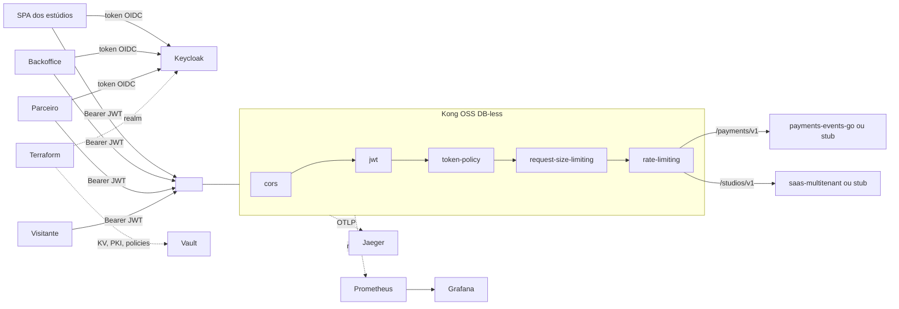

# platform-edge


Plataforma de entrada compartilhada (API gateway, identidade, segredos e observabilidade) que fica na frente do processador de pagamentos ([payments-events-go](https://github.com/JohnnyMatteus/payments-events-go)) e do SaaS de agendamento de estúdios ([saas-multitenant](https://github.com/JohnnyMatteus/saas-multitenant)) do ecossistema fictício do portfólio.

## O problema

Um provedor de pagamentos e uma plataforma de agendamento para estúdios de yoga e pilates expõem APIs para três tipos de cliente: a SPA dos estúdios, o backoffice de pagamentos e integrações de parceiros. Sem uma borda comum:

- um parceiro com bug num laço manda milhares de cobranças por minuto e derruba o processamento para todos;
- uma rota nova publicada sem checagem de papel expõe a área administrativa dos estúdios;
- cada produto valida tokens do seu jeito, e ninguém consegue responder "quem chamou o quê, quantas vezes, e com que resultado".

A platform-edge resolve isso com **políticas de autenticação e de rate limit como código**, versionadas, revisadas em PR e testadas de ponta a ponta.

## O que já funciona

- Gateway **Kong OSS (DB-less)** com rotas para os dois produtos e fallback automático para stubs quando eles não estão de pé.
- **JWT** do Keycloak validado localmente (RS256, `exp`, vida máxima, `iss`, `aud`, client conhecido).
- **Autorização por papel e por rota** num plugin próprio (`token-policy`) com **negação por padrão**.
- **Rate limit por client e por rota**, cota contratada por parceiro, limite por IP na rota anônima, **429 com `RateLimit-*` e `Retry-After`**.
- **CORS** restrito e **limite de payload** (global e por rota).
- **Keycloak** com realm exportado (clients, papéis, usuários fictícios) e **Vault** em modo dev.
- **Terraform** para o realm (provider keycloak) e para policies e secrets engines do Vault (provider vault), aplicável contra a stack local.
- **Chart Helm** do gateway endurecido (não-root, filesystem somente leitura, NetworkPolicy, HPA, PDB).
- **Prometheus, Grafana e Jaeger**: SLOs de disponibilidade e latência, alertas de burn rate testados com `promtool`, dashboard provisionado e traces OTLP.

## Arquitetura



Detalhes no [design doc](docs/design-doc.md).

| Diretório | Conteúdo |
| --- | --- |
| `gateway/` | Imagem do Kong, `declarative/kong.yaml` (políticas) e o plugin `token-policy` com testes Lua |
| `keycloak/` | Realm `edge` exportado e par RSA DEV ONLY |
| `terraform/` | Módulos `keycloak-realm` e `vault-edge`, ambiente `envs/local` |
| `charts/edge-gateway/` | Chart Helm do gateway |
| `observability/` | Prometheus (regras de SLO e testes), Grafana (provisionamento e dashboard) |
| `cmd/`, `internal/` | Upstream stub em Go |
| `tests/smoke/` | Smoke tests das políticas contra a stack |
| `init/aws/` | Bootstrap do LocalStack (profile `tools`) |

## Como rodar

Pré-requisitos: Docker 27+ e Go 1.25+. Terraform, Helm, promtool e kubeconform rodam via Docker.

```bash
cp .env.example .env     # opcional: portas e credenciais locais
make up                  # cria a rede portfolio-net e sobe os profiles core e observability
make ps
```

| Serviço | URL | Credencial (DEV ONLY) |
| --- | --- | --- |
| Gateway | http://localhost:8000 | tokens do Keycloak |
| Keycloak | http://localhost:8080 | `admin` / `dev-only-change-me` |
| Vault | http://localhost:8200 | token `dev-only-root-token` |
| Grafana | http://localhost:3000 | anônimo (Viewer) ou `admin` / `dev-only-change-me` |
| Prometheus | http://localhost:9090 | |
| Jaeger | http://localhost:16686 | |

Profiles do compose: `core` (gateway, stubs, Keycloak, Vault), `observability` (Prometheus, Grafana, Jaeger) e `tools` (LocalStack). Exemplos: `make up PROFILES=core` e `make up PROFILES=core,observability,tools`.

Usuários fictícios (senha `dev-only-change-me`): `ana.operadora` (pagamentos), `bruno.instrutor` (leitura de estúdios), `carla.gestora` (admin de estúdios), `diego.visitante` (sem papéis).

```bash
TOKEN=$(curl -s -d grant_type=password -d client_id=studio-portal \
  -d username=bruno.instrutor -d password=dev-only-change-me \
  http://localhost:8080/realms/edge/protocol/openid-connect/token | jq -r .access_token)

curl -i http://localhost:8000/studios/v1/classes                                       # 401
curl -i -H "Authorization: Bearer $TOKEN" http://localhost:8000/studios/v1/classes       # 200
curl -i -H "Authorization: Bearer $TOKEN" http://localhost:8000/studios/v1/admin/plans   # 403
```

Para aplicar o Terraform contra a stack local (cria o realm `edge-iac` e grava os segredos dos clients no Vault): `make seed`.

Para rodar atrás do gateway os projetos reais, veja [rede compartilhada do portfólio](docs/rede-portfolio.md).

## Como testar

| Comando | O que roda |
| --- | --- |
| `make test` | Testes Go do stub (com `-race`), 17 testes Lua da política e testes `promtool` dos alertas |
| `make test-integration` | Smoke tests Go contra a stack (exige `make up`): 401, 403, 429, 413, 200, CORS, cabeçalhos de segurança e identidade propagada |
| `make lint` | gofmt e go vet, `kong config parse`, `terraform fmt -check` e `validate`, `helm lint`, `promtool check` |
| `make kubeconform` | `helm template` validado com kubeconform em três conjuntos de valores |
| `make ci` | Tudo o que o CI roda, menos os smoke tests |

Os smoke tests pegam tokens reais no Keycloak e também **forjam tokens** com a chave DEV ONLY do realm para provar as rejeições que o Keycloak nunca emitiria (issuer, audiência, expiração, client desconhecido). Rode-os com os produtos reais desligados, porque eles conferem o eco dos stubs.

## Decisões principais

| ADR | Decisão |
| --- | --- |
| [0001](docs/adr/0001-kong-oss-db-less-como-gateway.md) | Kong OSS DB-less em vez de KrakenD, pelo rate limit com cabeçalhos e cota por cliente |
| [0002](docs/adr/0002-jwt-com-chave-publica-por-consumer.md) | JWT validado localmente, consumer por client via `azp` |
| [0003](docs/adr/0003-autorizacao-por-papel-em-plugin-proprio.md) | Plugin `token-policy` com política pura testável e negação por padrão |
| [0004](docs/adr/0004-rate-limit-por-consumer-e-rota.md) | Rate limit por consumer e rota, contagem local |
| [0005](docs/adr/0005-realm-exportado-em-dev-e-terraform-em-ambientes.md) | Realm exportado no local, Terraform nos ambientes |
| [0006](docs/adr/0006-vault-kv-pki-approle.md) | Vault com KV v2, PKI e AppRole por Terraform |
| [0007](docs/adr/0007-ferramentas-via-docker-e-makefile-unico.md) | Ferramentas via Docker e Makefile como contrato do CI |
| [0008](docs/adr/0008-slos-com-burn-rate-multijanela.md) | SLOs com burn rate em múltiplas janelas |
| [0009](docs/adr/0009-localstack-secrets-manager-como-alternativa-ao-vault.md) | LocalStack Secrets Manager como alternativa comparada ao Vault |

Roteiros do núcleo, com perguntas de entrevista: [autenticação e autorização](docs/roteiros/autenticacao.md) e [rate limit](docs/roteiros/rate-limit.md).

Mais documentação: [hardening OWASP](docs/seguranca-owasp.md), [SLOs e alertas](docs/slos.md), [runbooks](docs/runbooks.md), [observabilidade](docs/observabilidade.md).

## Trade-offs

- **Validação local de JWT**: o gateway não depende do Keycloak no caminho da requisição, mas a revogação não é imediata (vale até o token expirar, 5 min) e a rotação de chave exige atualizar o `kong.yaml`.
- **Rate limit em Redis**: cota exata entre réplicas ([ADR 0010](docs/adr/0010-rate-limit-compartilhado-com-redis.md)), ao custo de um componente a mais; se o Redis cair, o tráfego passa sem limite (`fault_tolerant`).
- **Plugin próprio**: preenche o que o Kong OSS não tem (papéis por claim), ao custo de manter código Lua acoplado à versão do Kong.
- **Chave RSA fixa no ambiente local**: permite validar offline e forjar tokens nos testes; só existe porque é DEV ONLY.
- **Fallback para stubs por peso**: com o produto real de pé, cerca de 0,1% das requisições locais ainda vai ao stub (o Kong OSS não tem alvo de reserva).

## Próximos passos

- Gerar a chave pública do `kong.yaml` a partir do JWKS do Keycloak por um job de CI (não é viável dentro do Kong OSS DB-less, ver ADR 0010).
- Redis com alta disponibilidade e alerta de indisponibilidade; rate limit por usuário e por plano.
- mTLS gateway → upstream com a PKI do Vault; auth method Kubernetes no Vault.
- GitOps com Argo CD para o chart e `terraform plan` em PR.
- Testes de carga (k6) para calibrar cotas e o SLO de latência.
- Gerar o realm JSON a partir do módulo Terraform.
- Imagem do Keycloak com `kc.sh build` já feito e `start --optimized`, para não refazer o build do Quarkus a cada subida (rascunho testado só até o build da imagem).
- Rodar os smoke tests com o fallback para stubs pelos upstreams do Kong: a configuração passa no `kong config parse` e a rota pública respondeu 200 pelo stub, mas a suíte completa desta versão fica para o CI.
- Ensaiar a `portfolio-net` com o payments-events-go e o saas-multitenant de pé (contrato em `docs/rede-portfolio.md`).

## Licença

[MIT](LICENSE)
