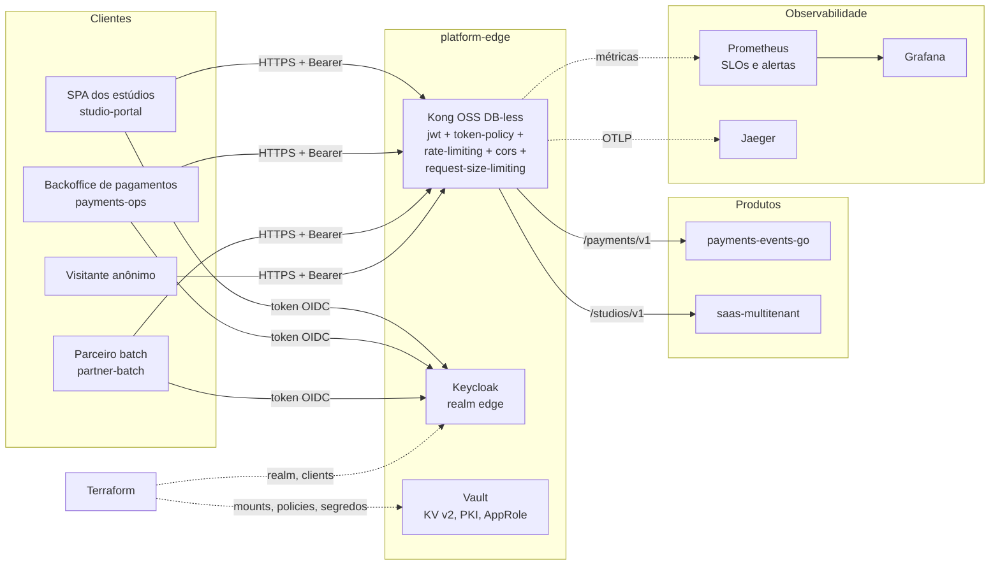
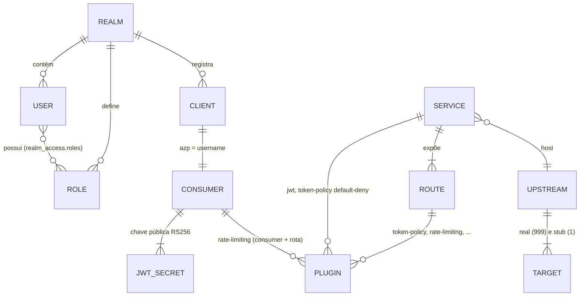
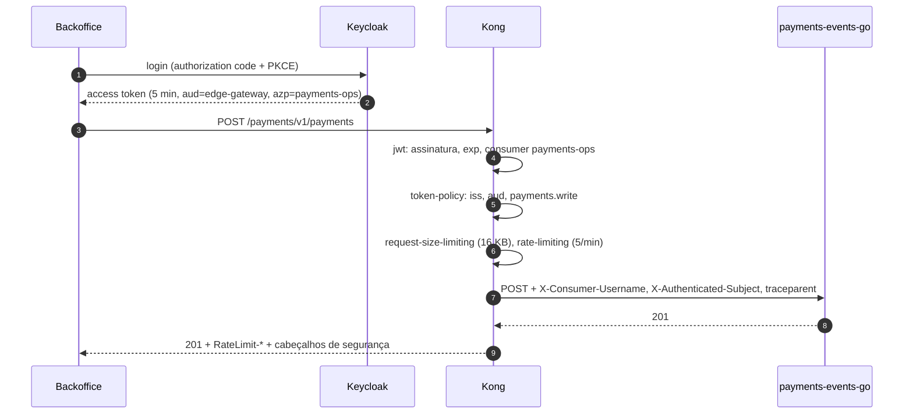
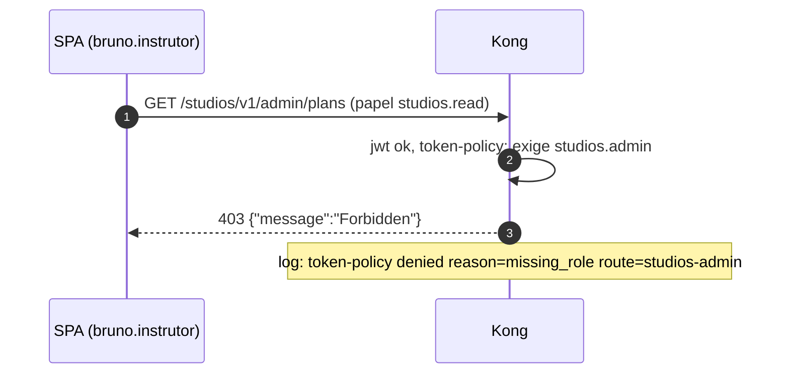
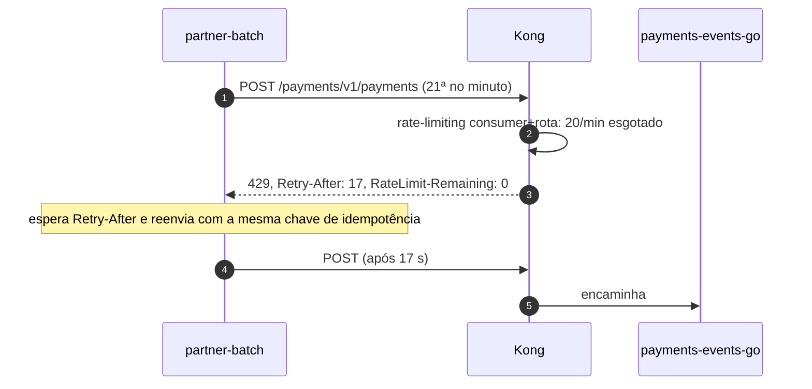
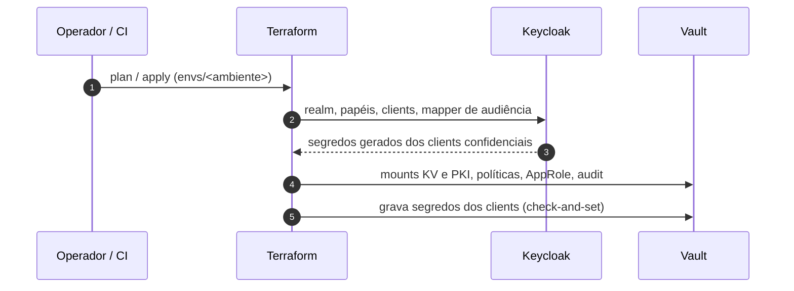

# Design doc: plataforma de entrada (platform-edge)

- Autor: Johnny Santos
- Status: Fundação implementada
- Última revisão: 2026-11-21

## 1. Contexto

O ecossistema fictício tem dois produtos expostos à internet:

- **payments-events-go**: processador de eventos de um provedor de pagamentos. Recebe cobranças de um backoffice e de integrações de parceiros.
- **saas-multitenant**: SaaS de agendamento para estúdios de yoga e pilates. Atende uma SPA usada por instrutores e gestores e uma agenda pública.

Cada produto validava identidade e protegia a própria capacidade do seu jeito. Isso gera três problemas de negócio: um parceiro com bug derruba o processador de pagamentos para todos; uma rota esquecida sem autorização expõe dados; e não existe um lugar único para responder "quem chamou o quê, e quanto".

A plataforma de entrada é a infraestrutura compartilhada que resolve isso: um gateway com políticas como código, um provedor de identidade, um cofre de segredos e observabilidade de borda, todos reproduzíveis localmente e com caminho para Kubernetes.

## 2. Objetivos

1. Toda requisição autenticada por JWT do Keycloak antes de chegar a um produto, sem acoplar o caminho da requisição à disponibilidade do Keycloak.
2. Autorização por papel e por rota, com negação por padrão.
3. Rate limit por client e por rota, com 429 e cabeçalhos que permitem ao cliente se ajustar; cota diferenciada por contrato.
4. CORS e limite de payload na borda.
5. Políticas versionadas, revisadas em PR e testadas automaticamente (unidade e ponta a ponta).
6. Realm e cofre como código (Terraform); gateway empacotado para Kubernetes (Helm).
7. SLOs de disponibilidade e latência com alertas de burn rate testados.

## 3. Não-objetivos

- Autorização fina por objeto ou tenant (fica nos produtos, que recebem o `sub` confiável).
- WAF, proteção volumétrica (DDoS) e bot management (CDN/WAF à frente do gateway).
- Portal de desenvolvedores, monetização de APIs, transformação de payload.
- Alta disponibilidade do Keycloak e do Vault (modo dev localmente).
- Deploy real em nuvem nesta fase: o chart é validado (lint, template, kubeconform), não instalado.

## 4. Arquitetura

| Componente | Responsabilidade | Tecnologia |
| --- | --- | --- |
| Gateway | Roteamento e políticas de borda | Kong OSS 3.9 DB-less, imagem própria com o plugin `token-policy` |
| `token-policy` | Issuer, audiência, papéis por rota, default-deny, identidade confiável | Plugin Lua, política pura testada com luajit |
| Identidade | Emissão de tokens, papéis, clients | Keycloak 26 (realm exportado em dev, Terraform em ambientes) |
| Segredos | Segredos de clients, CA interna para mTLS | Vault 1.18 (Terraform) |
| Upstreams locais | Imitam os produtos e ecoam o que o gateway propagou | Stub em Go (stdlib) |
| Observabilidade | Métricas, SLOs, dashboards, traces | Prometheus, Grafana, Jaeger |
| Empacotamento | Deploy no Kubernetes | Chart Helm `edge-gateway` |

Localmente, o gateway alcança os produtos reais pela rede `portfolio-net` quando estão de pé e cai nos stubs quando não estão ([rede-portfolio.md](rede-portfolio.md)).

## 5. Modelo de dados

O gateway não tem banco. O "modelo" são as entidades da configuração declarativa e do realm:

Claims usadas do token:

| Claim | Uso |
| --- | --- |
| `azp` | Escolhe o consumer (client) e, com ele, a chave pública e a cota |
| `exp`, `iat` | Expiração e vida máxima (15 min) |
| `iss` | Precisa estar em `allowed_issuers` |
| `aud` | Precisa conter `edge-gateway` (mapper em todos os clients) |
| `realm_access.roles` | Papéis conferidos por rota |
| `sub` | Propagado como `X-Authenticated-Subject` |

## 6. Fluxos principais

### 6.1 Requisição autorizada (backoffice cria pagamento)

### 6.2 Papel insuficiente

### 6.3 Cota esgotada

### 6.4 Provisionamento (Terraform)

## 7. Falhas e como são tratadas

| Falha | Efeito | Tratamento |
| --- | --- | --- |
| Keycloak fora | Novos logins falham | Gateway valida localmente; tokens valem até expirar; alerta `KeycloakDown` |
| Chave do realm rotacionada sem atualizar o gateway | 401 em massa | Alerta `EdgeAuthFailuresSpike`; procedimento de rotação no roteiro; sincronização por JWKS nos próximos passos |
| Upstream fora | 502/503 | Health checks ativos e passivos tiram o alvo; burn rate de disponibilidade alerta |
| Upstream lento | 504 depois de 5 s | Timeouts por serviço; alerta de latência |
| POST de pagamento com falha de rede | Risco de duplicidade | `retries: 0` no serviço de pagamentos; cliente reenvia com chave de idempotência |
| Rota publicada sem política | Seria acesso aberto | Default-deny: 403 |
| Plugin `token-policy` sem `jwt` na frente | Seria bypass | Falha fechada: 401 |
| Configuração inválida | Gateway não sobe | `kong config parse` no CI; imagem imutável e rollback por tag |
| Contador de rate limit indisponível | Sem limite temporariamente | `fault_tolerant: true` (escolha consciente por disponibilidade) |
| Vault fora | Sem impacto no caminho da requisição | O gateway não lê o Vault em tempo de requisição |

## 8. Segurança

Resumo; detalhes em [seguranca-owasp.md](seguranca-owasp.md).

- Autenticação: RS256, `exp` e vida máxima, `iss`, `aud`, client conhecido, token só no cabeçalho.
- Autorização: papel por rota e método, default-deny, identidade propagada sem possibilidade de spoofing.
- Consumo de recursos: rate limit por client e rota, limite de payload, timeouts.
- Configuração: Admin API só em loopback, cabeçalhos de implementação removidos, cabeçalhos de segurança, CORS restrito.
- Runtime: não-root, filesystem somente leitura, `no-new-privileges`, NetworkPolicy, schema do chart impede afrouxar o `securityContext`.
- Segredos: nenhum segredo real versionado; Vault com menor privilégio e audit.

## 9. Observabilidade

Detalhes em [observabilidade.md](observabilidade.md) e [slos.md](slos.md).

- Métricas por rota, código e client; latência total, do upstream e do gateway.
- Traces OTLP com contexto W3C propagado ao upstream; `X-Kong-Request-Id` em resposta, upstream e log.
- Logs JSON com `Authorization` redigido; negações com motivo.
- SLOs: 99,9% sem 5xx e 99% abaixo de 400 ms em 30 dias, com burn rate multijanela.

## 10. Alternativas consideradas

| Tema | Escolha | Alternativas | ADR |
| --- | --- | --- | --- |
| Gateway | Kong OSS DB-less | KrakenD CE, Kong com banco, Envoy, OpenResty | [0001](adr/0001-kong-oss-db-less-como-gateway.md) |
| Validação de JWT | Local, consumer por `azp` | Introspecção, JWKS em plugin próprio, consumer por issuer | [0002](adr/0002-jwt-com-chave-publica-por-consumer.md) |
| Autorização | Plugin próprio com default-deny | `acl`, `pre-function`, OPA | [0003](adr/0003-autorizacao-por-papel-em-plugin-proprio.md) |
| Rate limit | Por consumer e rota, local | Redis, IP, global | [0004](adr/0004-rate-limit-por-consumer-e-rota.md) |
| Realm | JSON em dev, Terraform em ambientes | Só Terraform, keycloak-config-cli | [0005](adr/0005-realm-exportado-em-dev-e-terraform-em-ambientes.md) |
| Segredos | Vault (KV, PKI, AppRole) | Kubernetes Secrets, secrets manager da nuvem, SOPS | [0006](adr/0006-vault-kv-pki-approle.md) |
| Ferramentas | Docker + Makefile como contrato | Actions específicas, toolbox | [0007](adr/0007-ferramentas-via-docker-e-makefile-unico.md) |
| SLOs | Burn rate multijanela | Limiar fixo, Sloth | [0008](adr/0008-slos-com-burn-rate-multijanela.md) |
| Cofre na AWS | LocalStack como comparação | Trocar o Vault | [0009](adr/0009-localstack-secrets-manager-como-alternativa-ao-vault.md) |

## 11. Plano de evolução

| Fase | Entrega | Motivo |
| --- | --- | --- |
| 1 (esta) | Fundação: compose, políticas, smoke tests, Terraform, Helm, SLOs | Núcleo defensável |
| 2 | Sincronização da chave pública a partir do JWKS (job que gera o trecho do `kong.yaml`) | Rotação sem passo manual |
| 2 | `policy: redis` no rate limit quando houver mais de uma réplica | Cota exata |
| 3 | mTLS gateway → upstream com certificados da PKI do Vault | Confiança zero na rede interna |
| 3 | Auth method Kubernetes no Vault e Vault Agent para o gateway | Sem AppRole no cluster |
| 3 | GitOps com Argo CD aplicando o chart por ambiente; `terraform plan` em PR | Deploy auditável |
| 4 | Rate limit por usuário (`sub`) e por plano | Justiça entre usuários do mesmo client |
| 4 | Testes de carga (k6) para calibrar cotas e o SLO de latência | Números com base em medição |
| 4 | Geração do realm JSON a partir do Terraform | Uma fonte da verdade |
