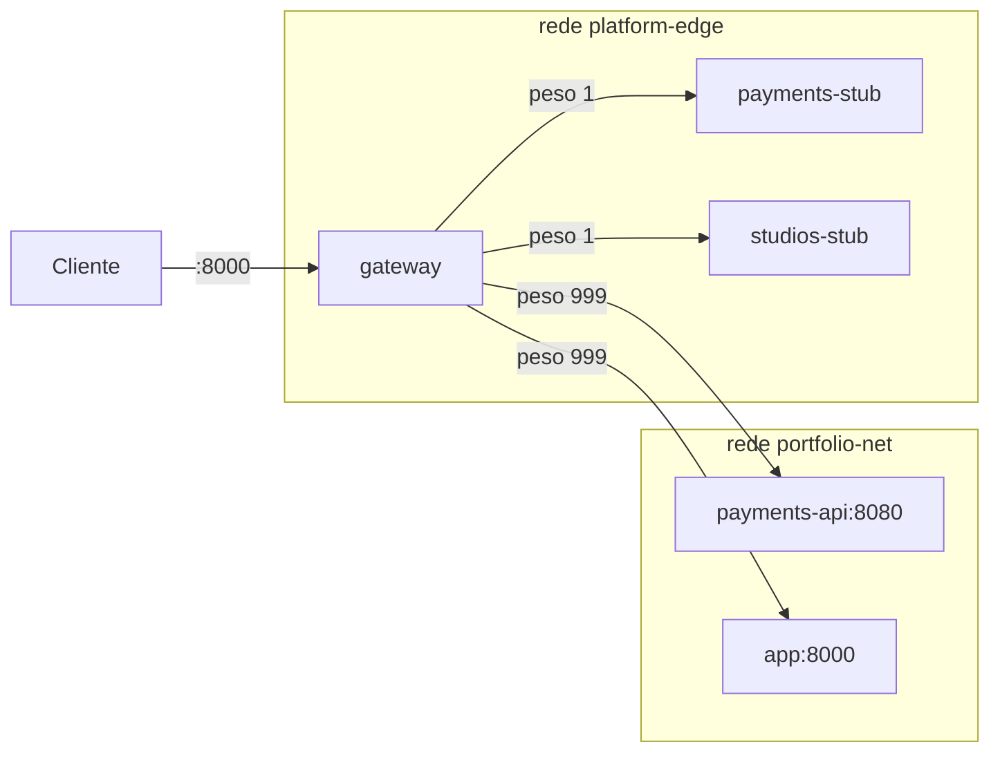

# Rede compartilhada do portfólio (`portfolio-net`)

A plataforma de entrada fica na frente de dois outros projetos do ecossistema fictício: o processador de pagamentos (**payments-events-go**) e o SaaS de agendamento de estúdios (**saas-multitenant**). Localmente, cada projeto tem o próprio `docker-compose.yml`. Eles se enxergam por uma rede Docker compartilhada, externa a todos os composes.



## Como usar

```bash
make network                         # cria a portfolio-net (make up já chama)
make up                              # sobe a borda
# em outro repositório, com o serviço ligado à portfolio-net:
docker compose up -d                 # payments-events-go ou saas-multitenant
```

## Fallback para os stubs

Os serviços do Kong apontam para upstreams (`payments.upstream` e `studios.upstream`) com dois alvos cada:

| Upstream | Alvo real (peso 999) | Stub (peso 1) | Health check ativo |
| --- | --- | --- | --- |
| `payments.upstream` | `payments-api:8080` | `payments-stub:8080` | `GET /healthz` |
| `studios.upstream` | `app:8000` | `studios-stub:8080` | `GET /up` |

- **Projeto real fora do ar**: o nome não resolve ou o health check falha duas vezes; o Kong tira o alvo do balanceamento e todo o tráfego vai para o stub. É assim que a borda roda sozinha, no CI e nos smoke tests.
- **Projeto real no ar**: o health check passa e o alvo volta em até 5 segundos, recebendo cerca de 99,9% das requisições.
- **Limitação conhecida**: com os dois saudáveis, cerca de 0,1% das requisições ainda cai no stub. O Kong OSS não tem alvo de reserva (*backup target*); pesos com health check são a aproximação disponível. Em produção não existe stub, então o problema não existe lá.
- Os smoke tests conferem campos que só o stub ecoa (por exemplo, o `subject` recebido). Rode-os com os outros projetos desligados, como faz o CI.

## Contrato para os outros projetos

Para entrar atrás do gateway, um projeto precisa:

1. ligar o container de API à rede `portfolio-net` (declarada como `external: true` no compose dele);
2. responder pelo nome e porta da tabela acima nessa rede (nome do serviço ou `aliases`);
3. expor o health check (`/healthz` no pagamentos, `/up` no SaaS) sem autenticação;
4. confiar nos cabeçalhos que o gateway injeta (`X-Consumer-Username`, `X-Authenticated-Subject`, `X-Kong-Request-Id`, `traceparent`) apenas quando a requisição vem do gateway, e continuar fazendo a autorização fina (por tenant, por recurso).

Exemplo no compose do outro projeto:

```yaml
services:
  api:
    networks:
      default: {}
      portfolio-net:
        aliases: [payments-api]

networks:
  portfolio-net:
    external: true
```

## Rotas reais conferidas nos projetos

Conferidas no código (somente leitura) neste ambiente:

| Projeto | Porta na `portfolio-net` | Nome na rede | Rotas HTTP reais | No gateway |
| --- | --- | --- | --- | --- |
| payments-events-go | 8080 | `payments-api` (alias do `docker-compose.portfolio.yml`) | `POST /webhooks/pagafacil`, `GET /healthz`, `/readyz`, `/metrics` | `payments-webhook-pagafacil` (anônima, HMAC no serviço, limite por IP) |
| saas-multitenant | 8000 | `app` (nome do serviço; sem alias) | `/api/v1/*` (Laravel: `studio`, `me`, `sessions`, `instructors`, `class-series`, `bookings`), `GET /up`, `/metrics` | `studios-api` em `/api/v1` (leitura, papel `studios.read` ou `studios.admin`) |

Pendências que dependem dos outros repositórios:

- O payments-events-go não expõe API REST de pagamentos (`/payments/v1/*`): essas rotas do gateway só existem nos stubs. O serviço real recebe só o webhook.
- O saas-multitenant valida o próprio JWT (realm `estudios`, issuer e JWKS próprios), não o do realm `edge`; o token do gateway só passaria se os dois realms forem unificados. As rotas `/studios/v1/*` também só existem nos stubs.
- O nome `app` é genérico: o ideal é o saas-multitenant declarar um alias (por exemplo `saas-multitenant`) na `portfolio-net`.
