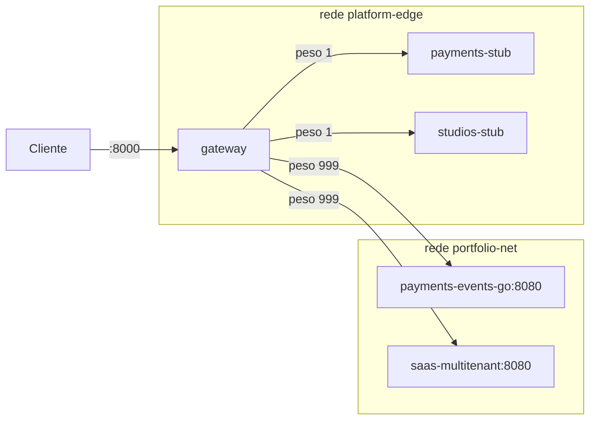

# Rede compartilhada do portfólio (`portfolio-net`)

A plataforma de entrada fica na frente de dois outros projetos do ecossistema fictício: o processador de pagamentos (**payments-events-go**) e o SaaS de agendamento de estúdios (**saas-multitenant**). Localmente, cada projeto tem o próprio `docker-compose.yml`. Eles se enxergam por uma rede Docker compartilhada, externa a todos os composes.



## Como usar

```bash
make network                         # cria a portfolio-net (make up já chama)
make up                              # sobe a borda
# em outro repositório, com o serviço ligado à portfolio-net:
docker compose up -d                 # payments-events-go ou saas-multitenant
```

## Fallback para os stubs

Os serviços do Kong apontam para upstreams (`payments.upstream` e `studios.upstream`) com dois alvos cada:

| Upstream | Alvo real (peso 999) | Stub (peso 1) | Health check ativo |
| --- | --- | --- | --- |
| `payments.upstream` | `payments-events-go:8080` | `payments-stub:8080` | `GET /healthz` |
| `studios.upstream` | `saas-multitenant:8080` | `studios-stub:8080` | `GET /up` |

- **Projeto real fora do ar**: o nome não resolve ou o health check falha duas vezes; o Kong tira o alvo do balanceamento e todo o tráfego vai para o stub. É assim que a borda roda sozinha, no CI e nos smoke tests.
- **Projeto real no ar**: o health check passa e o alvo volta em até 5 segundos, recebendo cerca de 99,9% das requisições.
- **Limitação conhecida**: com os dois saudáveis, cerca de 0,1% das requisições ainda cai no stub. O Kong OSS não tem alvo de reserva (*backup target*); pesos com health check são a aproximação disponível. Em produção não existe stub, então o problema não existe lá.
- Os smoke tests conferem campos que só o stub ecoa (por exemplo, o `subject` recebido). Rode-os com os outros projetos desligados, como faz o CI.

## Contrato para os outros projetos

Para entrar atrás do gateway, um projeto precisa:

1. ligar o container de API à rede `portfolio-net` (declarada como `external: true` no compose dele);
2. responder pelo nome `payments-events-go` ou `saas-multitenant` nessa rede (nome do serviço ou `aliases`), na porta 8080;
3. expor o health check (`/healthz` no pagamentos, `/up` no SaaS) sem autenticação;
4. confiar nos cabeçalhos que o gateway injeta (`X-Consumer-Username`, `X-Authenticated-Subject`, `X-Kong-Request-Id`, `traceparent`) apenas quando a requisição vem do gateway, e continuar fazendo a autorização fina (por tenant, por recurso).

Exemplo no compose do outro projeto:

```yaml
services:
  api:
    networks:
      default: {}
      portfolio-net:
        aliases: [payments-events-go]

networks:
  portfolio-net:
    external: true
```
