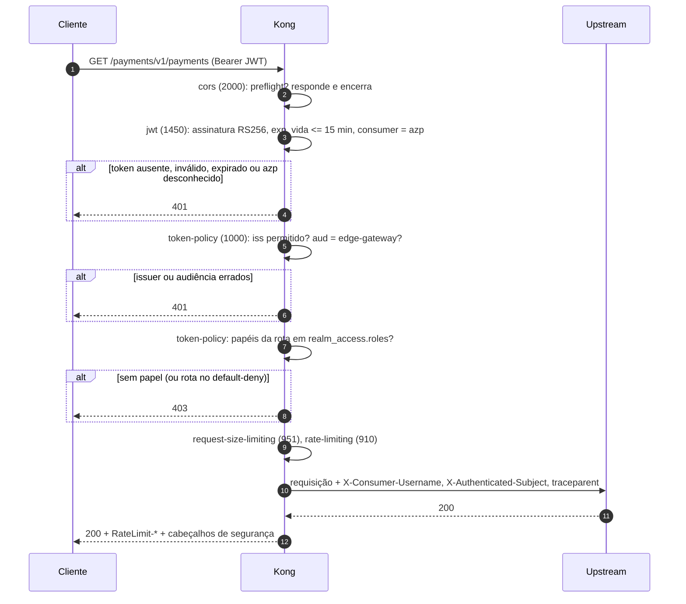

# Roteiro: políticas de autenticação e autorização

Este roteiro explica, para defesa em entrevista, como a borda decide se uma requisição entra: quem é o chamador (autenticação), o que ele pode fazer (autorização) e por que cada escolha foi feita.

## O problema

Dois produtos (pagamentos e estúdios) e três tipos de chamador:

| Chamador | Client no Keycloak | Fluxo | Exemplo |
| --- | --- | --- | --- |
| SPA dos estúdios | `studio-portal` (público) | Authorization code + PKCE | Instrutor consulta a agenda |
| Backoffice de pagamentos | `payments-ops` (confidencial) | Authorization code (password grant só em dev) | Operadora cria um pagamento |
| Integração de parceiro | `partner-batch` (confidencial) | Client credentials | Parceiro envia lote de cobranças |

Sem a borda, cada serviço validaria tokens do seu jeito, e um serviço esquecido ficaria aberto.

## A solução em uma frase

O Kong valida o JWT localmente com a chave pública do realm, identifica o client pela claim `azp`, e o plugin `token-policy` confere issuer, audiência e papéis da rota; o que não tem política explícita é negado.

## O caminho de uma requisição



## Peças e onde estão

| Peça | Arquivo | O que faz |
| --- | --- | --- |
| Plugin `jwt` (nativo) | `gateway/declarative/kong.yaml` | Assinatura, `exp`, `maximum_expiration`, consumer por `azp` |
| Plugin `token-policy` | `gateway/plugins/kong/plugins/token-policy/` | `iss`, `aud`, papéis, default-deny, `X-Authenticated-Subject` |
| Política pura | `policy.lua` | Função `evaluate(claims, conf)` sem dependência do Kong |
| Testes unitários | `gateway/spec/policy_spec.lua` | 17 casos, incluindo claims malformadas |
| Testes de ponta a ponta | `tests/smoke/policies_test.go` | 401, 403, default-deny, identidade propagada |
| Realm | `keycloak/realm-edge.json` e `terraform/modules/keycloak-realm` | Papéis, clients, mapper de audiência |

## 401 ou 403?

- **401**: não sei quem você é ou não confio no seu token. Token ausente, malformado, assinatura inválida, expirado, vida longa demais, client desconhecido, issuer ou audiência errados.
- **403**: sei quem você é, mas você não pode isto. Papel insuficiente ou rota em default-deny.

Issuer e audiência errados dão 401 porque são falhas de confiança no token, não de permissão: um token de outro realm não identifica ninguém aqui.

## Decisões e alternativas

| Decisão | Alternativa | Por que não |
| --- | --- | --- |
| Validação local por chave pública (ADR 0002) | Introspecção a cada requisição | Keycloak no caminho crítico, latência e ponto único de falha |
| Consumer por client via `azp` | Consumer por issuer | Perde a identidade do client e o rate limit por cliente |
| Plugin próprio para papéis (ADR 0003) | `acl` do Kong | `acl` autoriza o client, não o papel do usuário |
| Default-deny com papel sentinela | Lembrar de pôr política em toda rota | Esquecimento vira rota aberta |
| Conferir `aud` | Só `iss` | Token emitido para outro sistema do mesmo realm seria aceito (confusão de audiência) |
| Vida máxima de 15 min no gateway | Confiar no realm | Defesa em profundidade se alguém aumentar a validade no Keycloak |

## Trade-offs que eu assumo

- **Revogação não é imediata.** Token roubado vale até expirar (5 min). Mitigação: vida curta, `revokeRefreshToken`. Se o negócio exigir revogação imediata, a opção é introspecção com cache curto só nas rotas críticas.
- **Rotação de chave manual.** A chave pública está no `kong.yaml`. O próximo passo é gerar essa parte da configuração a partir do JWKS, publicando a chave nova antes de ativá-la no Keycloak.
- **Autorização grossa.** O gateway decide por rota e papel. "Este instrutor só vê o próprio estúdio" é regra de domínio e fica no saas-multitenant, que recebe o `sub` confiável.

## Como demonstrar

```bash
make up
TOKEN=$(curl -s -d grant_type=password -d client_id=studio-portal \
  -d username=bruno.instrutor -d password=dev-only-change-me \
  http://localhost:8080/realms/edge/protocol/openid-connect/token | jq -r .access_token)

curl -i http://localhost:8000/studios/v1/classes                                  # 401
curl -i -H "Authorization: Bearer $TOKEN" http://localhost:8000/studios/v1/classes  # 200
curl -i -H "Authorization: Bearer $TOKEN" http://localhost:8000/studios/v1/admin/plans  # 403
make test-integration
```

## Perguntas de entrevista

**Por que não validar o token em cada serviço?**
Os serviços podem (e devem, em defesa em profundidade) validar, mas a borda garante uma política mínima uniforme e um único lugar para auditar. Sem ela, o serviço mais descuidado define a segurança do sistema.

**O que acontece se o Keycloak cair?**
Tokens já emitidos continuam válidos até expirar, porque a validação é local. Novos logins e renovações falham. Há o alerta `KeycloakDown`, e o gateway não precisa reiniciar.

**Como você rotacionaria a chave de assinatura sem derrubar ninguém?**
Gero a chave nova no Keycloak como passiva, publico a chave pública nova no gateway (o plugin `jwt` aceita mais de uma credencial; com `kid` seria por chave), ativo a nova no Keycloak, espero a vida máxima do token (15 min) e removo a antiga do gateway e do realm.

**Por que `azp` e não `sub` para o consumer?**
`sub` é o usuário; `azp` é o client que pediu o token. O rate limit e o contrato de cota são por client (aplicação), e um consumer por usuário não escalaria em configuração declarativa.

**Um atacante pode mandar `X-Authenticated-Subject: admin`?**
Não. O `token-policy` remove esse cabeçalho da requisição e o preenche com o `sub` do token validado. O smoke test `TestUpstreamReceivesTrustedIdentity` prova isso.

**E se alguém criar uma rota nova e esquecer a política?**
Cai na política do serviço, que exige o papel `edge.deny-by-default`, que ninguém tem: 403. A rota `payments-refunds` existe exatamente para o smoke test provar esse comportamento.

**Por que o 403 não consome cota de rate limit?**
O `token-policy` (prioridade 1000) roda antes do `rate-limiting` (910). Requisição negada não chega ao upstream, então não faz sentido cobrar cota; e assim um cliente mal configurado não esgota a cota legítima de outro usuário do mesmo client.

**Como testar a rejeição de um token com issuer errado se o Keycloak nunca emite um?**
Os smoke tests assinam tokens com a chave dev do realm e claims manipuladas (`iss`, `aud`, `exp`, `azp`). Isso só é possível porque a chave é DEV ONLY e está no repositório; em produção a chave privada nunca sai do Keycloak.

**Qual o maior risco dessa solução?**
A chave pública estática: esquecer de atualizar o gateway numa rotação gera 401 em massa. Mitigação atual: alerta `EdgeAuthFailuresSpike`. Mitigação definitiva: sincronização automática a partir do JWKS.
