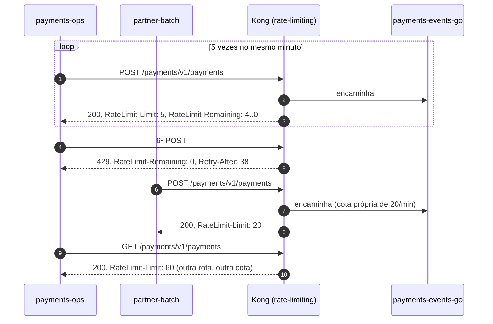

# Roteiro: rate limit por cliente e por rota

Este roteiro explica como a borda reparte capacidade entre clientes, como o cliente sabe o que fazer quando estoura, e o que muda quando o gateway tiver várias réplicas.

## O problema

- Um parceiro com bug num laço pode mandar milhares de cobranças por minuto e derrubar o processador de pagamentos.
- Uma rota cara (criar pagamento) não pode ter a mesma cota de uma barata (listar aulas).
- Um parceiro com contrato maior precisa de cota maior sem afrouxar a de todos.
- A rota pública da agenda não tem token, mas precisa de limite.
- O cliente precisa saber quanto esperar; sem isso, ele reenvia na hora e piora o problema.

## A solução em uma frase

Um plugin `rate-limiting` por rota, contando por consumer (o client do Keycloak) numa janela de um minuto, com cota específica para um par consumer + rota, limite por IP na rota anônima, e cabeçalhos `RateLimit-*` e `Retry-After` em toda resposta.

## Configuração atual

| Rota | Método | Limite | Chave |
| --- | --- | --- | --- |
| `payments-read` | GET | 60/min | client |
| `payments-write` | POST | 5/min (`partner-batch`: 20/min) | client |
| `studios-read` | GET | 120/min | client |
| `studios-admin` | GET, POST, PUT, DELETE | 30/min | client |
| `studios-public-schedule` | GET | 30/min | IP |

## Como funciona



Precedência de plugins no Kong: consumer + rota vence rota, que vence serviço, que vence global. É isso que dá ao `partner-batch` 20/min em `payments-write` sem mudar a cota dos outros.

Ordem de execução: `jwt` (1450) → `token-policy` (1000) → `request-size-limiting` (951) → `rate-limiting` (910). Requisição sem token ou sem papel nunca consome cota.

## Cabeçalhos

| Cabeçalho | Quando | Significado |
| --- | --- | --- |
| `RateLimit-Limit` | Sempre | Cota da janela |
| `RateLimit-Remaining` | Sempre | Quanto resta |
| `RateLimit-Reset` | Sempre | Segundos até a janela virar |
| `Retry-After` | No 429 | Segundos até poder tentar de novo |
| `X-RateLimit-*-Minute` | Sempre | Formato legado do Kong, mantido por compatibilidade |

Os cabeçalhos estão em `exposed_headers` do CORS, para a SPA conseguir ler.

## Decisões e alternativas

| Decisão | Alternativa | Por que não (por enquanto) |
| --- | --- | --- |
| Chave = client (consumer) | IP | NAT corporativo junta clientes; IP rotativo contorna |
| Chave = client | Usuário (`sub`) | Protege o upstream do client como um todo; por usuário fica para depois |
| Cota por rota | Cota única por serviço | Escrita estourada bloquearia leitura |
| `policy: local` | `policy: redis` | Sem dependência no caminho crítico na fundação (ADR 0004) |
| Janela fixa de 1 min | Janela deslizante | Deslizante é Enterprise no Kong |
| `fault_tolerant: true` | Falhar fechado | Se o contador falhar, prefiro deixar passar a derrubar todo o tráfego |
| Rate limit depois da autorização | Antes | Não cobrar cota de requisição que não chega ao upstream |

## Trade-offs que eu assumo

- **Contagem por nó.** Com 3 réplicas e balanceamento uniforme, o limite efetivo fica entre 1x e 3x o configurado. Para proteção é aceitável; para contrato de cota, troca-se para `redis`.
- **Rajada na virada da janela.** Janela fixa permite até 2x a cota em poucos segundos (fim de um minuto e começo do outro).
- **Usuários do mesmo client dividem a cota.** Um operador apressado pode afetar os colegas do backoffice. Limite por `sub` resolveria, com mais memória de contadores.
- **Rajada anônima de 401 não é limitada.** O `jwt` rejeita antes do rate limit. É barato para o gateway, mas um ataque volumétrico precisa ser contido antes (CDN ou WAF), registrado em próximos passos.

## Como demonstrar

```bash
make up
TOKEN=$(curl -s -d grant_type=password -d client_id=payments-ops \
  -d client_secret=dev-only-payments-ops-secret -d username=ana.operadora \
  -d password=dev-only-change-me \
  http://localhost:8080/realms/edge/protocol/openid-connect/token | jq -r .access_token)

for i in $(seq 1 6); do
  curl -s -o /dev/null -w '%{http_code}\n' -X POST -H "Authorization: Bearer $TOKEN" \
    http://localhost:8000/payments/v1/payments
done
curl -si -X POST -H "Authorization: Bearer $TOKEN" http://localhost:8000/payments/v1/payments | grep -iE 'ratelimit|retry'
```

No Grafana (http://localhost:3000), o painel "Rate limit por cliente" mostra o 429 por client e rota.

## Perguntas de entrevista

**Como você escolheu os números?**
Na fundação, são valores de demonstração pequenos para os testes estourarem rápido. Em produção, parto da capacidade medida do upstream (teste de carga), reservo folga para picos, divido pelos clientes ativos e ajusto pelo alerta `EdgeClientRateLimited`, que mostra quem bate na cota de forma sustentada.

**O que muda com várias réplicas do gateway?**
Com `policy: local`, cada réplica conta sozinha. Troco para `policy: redis` (contador central). O custo é uma ida ao Redis por requisição e uma dependência a mais; com `fault_tolerant: true`, se o Redis cair o tráfego passa sem limite, e eu prefiro isso a um apagão.

**Por que 429 e não 503?**
429 diz que o problema é o cliente (excedeu a cota) e que ele deve esperar `Retry-After`. 503 diz que o servidor está indisponível, o que confunde alertas de SLO e faz clientes acionarem retry agressivo.

**Respostas 429 consomem o orçamento de erro do SLO?**
Não. O SLO conta só 5xx. Há um teste de `promtool` que prova que 401, 403 e 429 não disparam o alerta de burn rate.

**Como o cliente deve reagir ao 429?**
Esperar `Retry-After` e reenviar com backoff exponencial e jitter. Para POST de pagamento, reenviar com a mesma chave de idempotência, que o payments-events-go trata.

**Por que não limitar por IP na rota autenticada também?**
Atrás de NAT corporativo, um escritório inteiro divide um IP; atrás de rede móvel, um cliente muda de IP. A identidade do client é mais estável e é a que tem contrato.

**Como dar cota maior para um parceiro sem mexer nos outros?**
Um plugin `rate-limiting` no par consumer + rota (`partner-batch` + `payments-write`). Pela precedência do Kong, ele vence o plugin da rota só para esse consumer. O smoke test confere que o parceiro recebe `RateLimit-Limit: 20` enquanto o padrão é 5.

**E rate limit por plano (gratuito, pago)?**
O mesmo mecanismo com grupos: consumer groups (Enterprise) ou um consumer por plano. Alternativa OSS: o `token-policy` poderia escrever o plano numa variável e um plugin de rate limit próprio usaria como chave.
